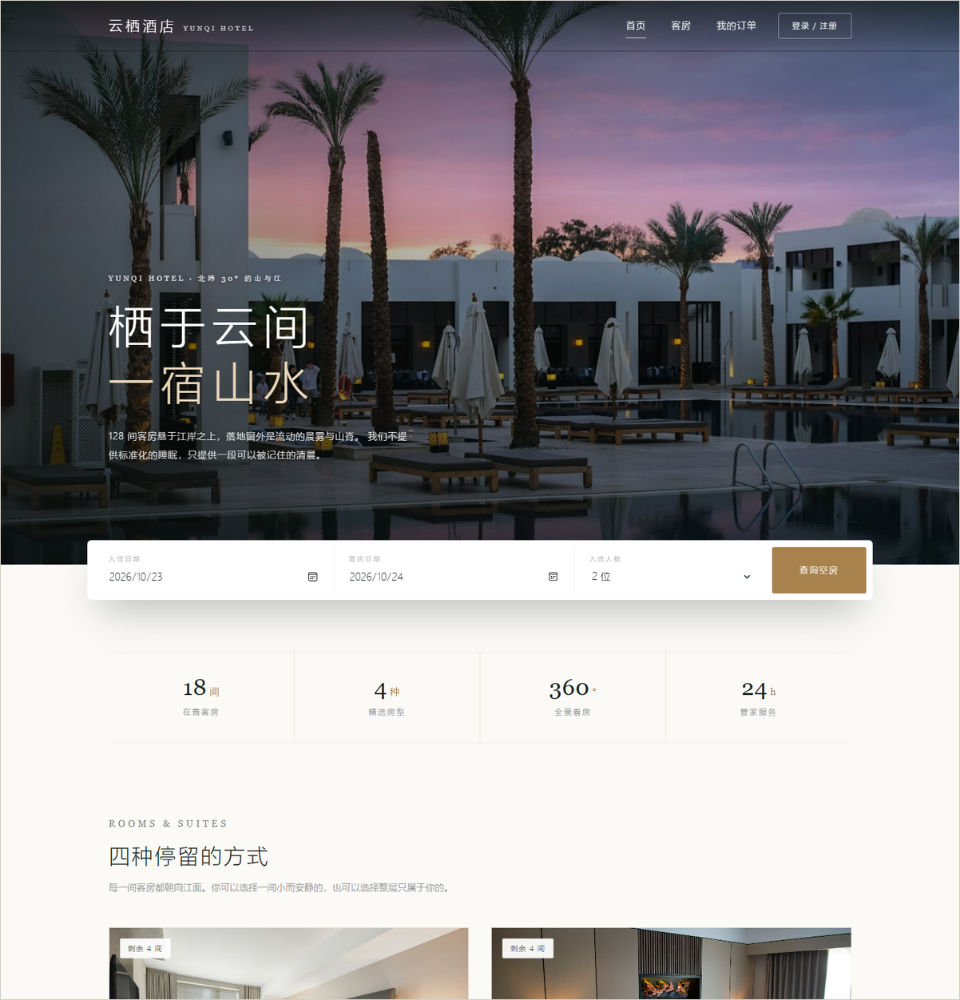
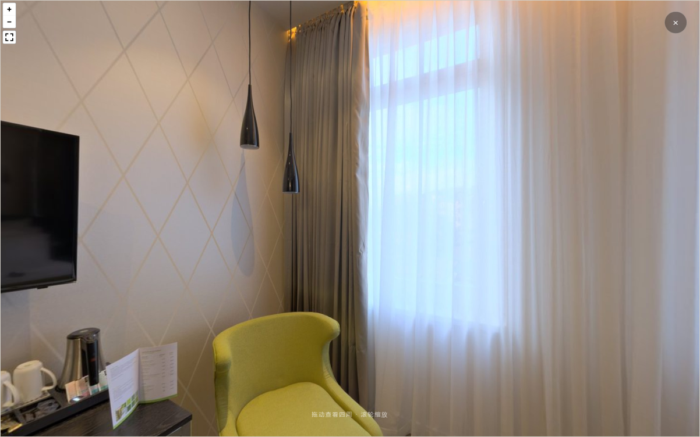

# 云栖酒店客房管理系统

> 《网页设计与网站建设》课程设计 · 选题三「酒店客房管理系统」
>
> 一个可以完整跑通的酒店预订系统：游客浏览房型 → 注册登录 → 在线订房 → 管理员确认入住 → 退房按中午 12 点规则结算。



---

## 功能概览

| 模块 | 主要功能 | 面向角色 |
|---|---|---|
| 客房浏览 | 首页推荐、按日期与人数筛选、房型详情、**360° 全景看房** | 游客 / 全部用户 |
| 账号管理 | 注册、登录、退出、修改密码 | 全部用户 |
| 在线预订 | 下单、自动分配可用房、订单查询、取消订单 | 个人用户 |
| 入住管理 | 确认入住、确认退房、按 12 点规则结算房费 | 管理员 |
| 客房维护 | 新增、编辑、删除客房，调整房态与维修停用 | 管理员 |
| 会员管理 | 调整会员等级、查看订单数与累计消费 | 管理员 |
| 经营分析 | 入住率指标、近 7 天入住率曲线、各房型占用 | 管理员 |

其中 **360° 全景看房**为题目指定的设计项，基于等距柱状投影全景图与 Pannellum 渲染库实现：



## 技术栈

- **前端**：原生 HTML5 / CSS3 / ES6，不使用框架与构建工具，由 Express 直接静态托管
- **后端**：Node.js + Express 5，23 个 REST 接口
- **数据库**：MySQL 8.0；通过适配器模式同时兼容内置 SQLite，可零配置运行
- **会话与安全**：express-session + bcrypt 密码哈希
- **可视化**：Pannellum 2.5（全景）、ECharts 5.5（图表），均本地化部署，断网可用

## 快速开始

```bash
cd hotel-system
npm install
npm run init      # 建库建表 + 灌入演示数据
npm start         # 打开 http://localhost:3000
```

Windows 下也可以直接双击 `hotel-system/启动演示.bat`，脚本会自动查找 Node 环境、检查依赖与数据并启动服务。

详细说明（含 MySQL 切换、目录结构、核心算法）见 [hotel-system/README.md](hotel-system/README.md)。

### 演示账号

| 角色 | 账号 | 密码 | 说明 |
|---|---|---|---|
| 管理员 | `admin` | `123456` | 可进入后台 |
| 普通用户 | `zhangxy` | `123456` | 普通会员 |
| 普通用户 | `liwenbo` | `123456` | 银卡会员（95 折） |
| 普通用户 | `chenjing` | `123456` | 金卡会员（9 折，14:00 退房） |

## 核心实现

**1. 日期区间冲突检测（防止一房两卖）**

```sql
SELECT room_id FROM bookings
 WHERE status IN ('pending','checked_in')
   AND check_in  < ?checkOut
   AND check_out > ?checkIn;
```

两条同时成立即为区间重叠。只有「已预订」与「入住中」的订单占用房间，已取消与已退房的不算。选房与写单在同一个事务内完成。

**2. 以中午 12 点为界的计费规则**

基础天数取「自然日差」与 1 之间的较大值，保证短时入住也收一天；退房时按实际时刻判断，超过 12 点加收一天，金卡会员宽限至 14:00。

**3. 三级权限控制**

后端 `requireLogin` / `requireAdmin` 两个中间件统一挂载，前端隐藏入口仅作体验优化，不作为安全边界。

## 目录结构

```
.
├── hotel-system/                  # 项目源码
│   ├── 启动演示.bat               # 双击启动
│   ├── server.js                  # 服务入口
│   ├── db/                        # 建表脚本与初始化
│   ├── src/                       # 路由、中间件、服务、工具
│   ├── public/                    # 页面、样式、脚本、图片
│   └── docs/                      # 报告配图与页面截图
└── 《网页设计与网站建设》实验报告_草稿.docx
```

## 说明

- 本项目为课程作业，非商业用途。
- 房型实拍图来自 Unsplash（免费授权），360° 全景图来自 Poly Haven（CC0）。
- 演示数据中的订单按当天日期动态生成，首次运行需执行 `npm run init`。
